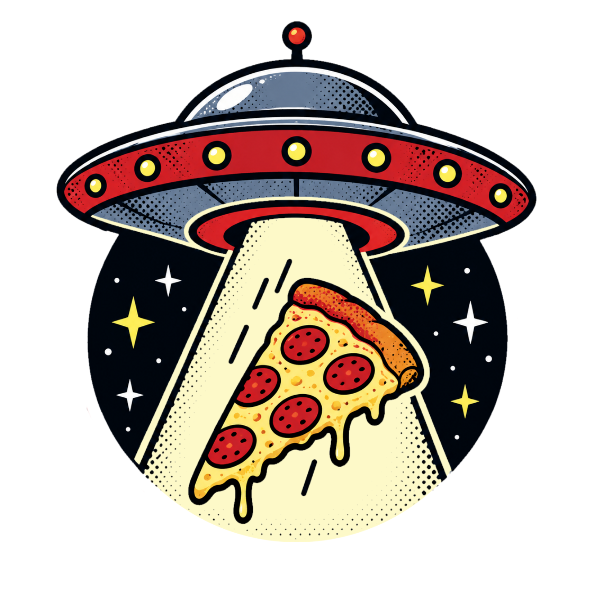

<!--
File: README.md
Document Title: Pizza Planet
Author: Alysha Pursley
Date: August 2026
-->

<div align="center">



<h1>Pizza Planet: A Pizza Ordering Chatbot Demo 🍕</h1>

<p><a href="https://github.com/apursley2012/pizza-planet/stargazers"></a> <a href="https://github.com/apursley2012/pizza-planet/forks"></a> <a href="https://github.com/apursley2012/pizza-planet/issues"></a> <a href="https://github.com/apursley2012/pizza-planet/commits"></a> <a href="https://github.com/apursley2012/pizza-planet"></a> <a href="https://github.com/apursley2012/pizza-planet"></a> <a href="https://github.com/apursley2012/pizza-planet"></a> <a href="https://github.com/apursley2012/pizza-planet/graphs/contributors"></a> <a href="https://github.com/apursley2012/pizza-planet/graphs/commit-activity"></a></p>

<p><a href="https://apursley2012.github.io/pizza-planet/"></a>   </p>

<p><strong>A conversational pizza-ordering application that guides customers through a complete order one decision at a time while maintaining a live receipt with pizzas, quantities, tax, delivery fees, payment choices, tips, and the final total.</strong></p>

<p><a href="https://apursley2012.github.io/pizza-planet/">Open the live project</a> · <a href="https://github.com/apursley2012/pizza-planet">View the repository</a> · <a href="https://github.com/apursley2012/pizza-planet/issues/new/choose">Report an issue or request an addition</a></p>

</div>

---

## Table of Contents 📖

*   [Project Overview 🔎](#project-overview)
    *   [Purpose 🎯](#purpose)
    *   [Design Style and Inspiration 🎨](#design-style-and-inspiration)
    *   [Main Color Palette 🌈](#main-color-palette)
    *   [Preview Screenshots 🖼️](#preview-screenshots)
*   [Key Features ✨](#key-features)
*   [Tech Stack 🛠️](#tech-stack)
*   [Live Demo 🚀](#live-demo)
*   [Installation 📦](#installation)
    *   [Local Use 💻](#local-use)
    *   [GitHub Pages Deployment 🌐](#github-pages-deployment)
*   [Usage 🧭](#usage)
*   [Project Structure 🗂️](#project-structure)
    *   [Pages Included 📄](#pages-included)
    *   [Core Files and Architecture 🧩](#core-files-and-architecture)
    *   [File and Folder Structure 🌳](#file-and-folder-structure)
*   [Ordering Model 🧮](#ordering-model)
*   [Customization Guide 🎨](#customization-guide)
*   [Accessibility and Browser Compatibility ♿](#accessibility-and-browser-compatibility)
*   [Repository Relationship 🔗](#repository-relationship)
*   [Project Scope and Limitations 📌](#project-scope-and-limitations)
*   [Possible Future Enhancements 💡](#possible-future-enhancements)
*   [Contributing 🤝](#contributing)
    *   [Reporting Issues 🐛](#reporting-issues)
    *   [Requesting Additions 📝](#requesting-additions)
*   [License 📜](#license)
*   [Important Links 🔗](#important-links)
*   [Attribution ℹ️️](#attribution)

---

<a id="project-overview"></a>

<details open>
<summary><h2><strong>Project Overview 🔎</strong></h2></summary>

**Pizza Planet** is a browser-based ordering application that replaces a long pizza-order form with a guided conversation. The customer answers one question at a time, while the application records each response, validates it, updates the order state, recalculates totals, and reflects the result immediately in a receipt panel beside the chat.

The ordering workflow is complete enough to behave like a small restaurant checkout rather than a scripted demo. A customer can choose pizza size, toppings, crust, quantity, add multiple different pizzas, select carryout or delivery, choose cash or card, enter demo card information, and optionally add a driver tip for delivery. The receipt keeps the customer name, fulfillment method, payment method, itemized pizzas, subtotal, tax, delivery fee, tip, and total visible throughout the process.

I also kept the supporting documentation connected to the application. The repository includes a case study, article, and source map alongside the working demo, so someone can use the application first and then inspect the reasoning, implementation, and relationship to the source material without treating those documents as separate projects.

</details>

<a id="purpose"></a>

<details open>
<summary><h3><strong>Purpose 🎯</strong></h3></summary>

I built this pizza ordering chatbot to make a multi-step ordering process easier to follow without forcing the customer to interpret a dense form all at once. Pizza ordering contains several dependent decisions: the selected size changes price, quantity changes line totals, delivery changes the final fee and whether a driver tip is relevant, and payment method changes which questions need to be asked. A conversational flow lets the application reveal only the next decision that matters.

The live receipt is equally important to the purpose of the project. I wanted every answer to have a visible consequence, so the application updates the item list and financial totals as the order develops. This makes the experience more transparent and makes the underlying JavaScript state easier to understand and test.

The project also preserves the personality of the original assistant while presenting it as a practical browser application. Alex reacts to answers, confirms added pizzas, explains payment behavior, reports the final total, provides a fast simulated ETA, and awards a coupon message for orders of at least $50.

</details>

<a id="design-style-and-inspiration"></a>

<details open>
<summary><h3><strong>Design Style and Inspiration 🎨</strong></h3></summary>

The design is built around a neighborhood-pizzeria counter rather than a generic chatbot interface. Warm cream and cheese tones create the food-service atmosphere, tomato and deep-red accents identify actions and status, basil green marks successful result messages, and very dark brown borders give the interface the heavy printed-sign and menu-board contrast used throughout the site.

The two-column desktop layout deliberately separates conversation from confirmation. The chat window is the active workspace, while the receipt behaves like the paper receipt a customer would keep beside them at a counter. Rounded panels and heavy offset shadows make the major surfaces feel tangible without hiding the form structure.

On smaller screens the layout collapses to one column, the navigation wraps, and the entry form becomes a vertical stack so the same workflow remains usable on a phone.

</details>

<a id="main-color-palette"></a>

<details open>
<summary><h3><strong>Main Color Palette 🌈</strong></h3></summary>

The palette below comes directly from `css/styles.css`. I included every named project color and the actual interface jobs it performs.

| Hex | Color Name | Complete Use in the Interface |
| --- | --- | --- |
| `#22130E` | Oven Black | Main panel borders; offset box shadows; navigation button backgrounds; skip-link background; pizza-icon border; chat and receipt borders; input borders; total-row border; footer-link borders; dark text on yellow footer buttons |
| `#B53A24` | Deep Red | Chat title bar; validation/error messages; receipt kicker; article headings |
| `#E4572E` | Tomato | Primary form and receipt buttons; navigation hover/focus state; alternating footer action buttons |
| `#FFD166` | Cheese Yellow | Pizza-icon background; user chat bubbles; order total panel; alternating footer buttons; warm page-gradient endpoint |
| `#FFF7ED` | Cream | Main pizzeria header and footer surfaces; navigation text; chat-feed base surface; skip-link text; warm page-gradient center |
| `#F8E4C9` | Flour Beige | Defined as a supporting warm neutral in the project palette for additional paper/food-surface styling; currently available in the stylesheet even where the current interface primarily uses Cream and White |
| `#5B7F45` | Basil Green | Successful/result chat bubbles that call out final outcomes |
| `#2B1B14` | Ink Brown | Primary body text; brand text; source color for dashed receipt dividers and translucent receipt-item borders |
| `#7C5C4B` | Muted Brown | Secondary brand copy; receipt labels; footer text; empty receipt text; receipt-item secondary text; footer hover/focus background |
| `#FFFFFF` | White | Chat window; bot bubbles; receipt paper; menu card; chat-entry surface; button text; result text; article cards; individual receipt items |
| `#00000033` | Shadow Black 20% | Defined stronger translucent shadow token for dark depth effects |
| `#00000018` | Soft Shadow Black | Bubble drop shadows |
| `#FFF7DB` | Receipt Warm Yellow | Background of the ordered-items section inside the receipt |
| `#00000008` | Grid Black | Fine grid lines in the chat-feed background |
| `#2B1B1444` | Ink Brown 27% | Dashed dividers between receipt rows and receipt line totals |
| `#2B1B1422` | Ink Brown 13% | Subtle border around individual pizza receipt items |
| `#00000044` | Shadow Black 27% | Preserved in the commented alternate footer treatment; not active in the current rendered footer |

The stylesheet also defines `--shadow` and `--flour` as reusable palette tokens even though the current active rules use the more specific colors above for most rendered surfaces.

</details>

<a id="preview-screenshots"></a>

<details open>
<summary><h3><strong>Preview Screenshots 🖼️</strong></h3></summary>

The repository contains an `images/screenshots/` folder, but the current GitHub version only contains its placeholder file. I have not invented screenshot filenames or linked to files that are not actually present.

When screenshots are added, they belong in `images/screenshots/` so the README can reference the verified files directly.

</details>


---

<a id="key-features"></a>

<details open>
<summary><h2><strong>Key Features ✨</strong></h2></summary>

* Conversational, step-by-step ordering instead of one large form
* Small, medium, and large pizza pricing at `$8.99`, `$14.99`, and `$17.99`
* Topping and crust entry
* Quantity validation and support for multiple pizzas
* Add-another-pizza loop without restarting the order
* Carryout/pickup and delivery normalization
* Cash and card payment branches
* Demo card-number, expiration-date, and CVV validation
* Delivery-driver tip handling for card delivery orders
* Itemized live receipt with per-pizza unit price and line total
* 10% sales-tax calculation
* `$5.00` delivery fee only when delivery is selected
* Final total recalculated from subtotal, tax, delivery fee, and tip
* `$10` next-order coupon message for orders totaling at least `$50`
* Simulated order-status/ETA messages after checkout
* Reset control that clears the complete state and starts a new order
* Case Study, Article, and Source Map pages linked from the same design system

</details>


---

<a id="tech-stack"></a>

<details open>
<summary><h2><strong>Tech Stack 🛠️</strong></h2></summary>

* **HTML5** for the application and supporting documentation pages
* **CSS3** for the pizzeria interface, responsive layout, palette, cards, receipt, and navigation
* **Vanilla JavaScript** for conversational state, validation, branching, calculations, DOM updates, and reset behavior
* **GitHub Pages** for the static live deployment

</details>


---

<a id="live-demo"></a>

<details open>
<summary><h2><strong>Live Demo 🚀</strong></h2></summary>

[https://apursley2012.github.io/pizza-planet/](https://apursley2012.github.io/pizza-planet/)

</details>


---

<a id="installation"></a>

<details open>
<summary><h2><strong>Installation 📦</strong></h2></summary>

Pizza Planet is a static browser project, so it does not require a backend, database, package installation, or build command for the current version.

</details>

<a id="local-use"></a>

<details open>
<summary><h3><strong>Local Use 💻</strong></h3></summary>

1. Clone or download the repository.
2. Keep `index.html`, `css/`, `js/`, `data/`, `docs/`, and the supporting pages in their existing relative locations.
3. Open `index.html` in a modern browser.
4. Test the complete order path, including multiple pizzas, carryout and delivery, cash and card, invalid input, tips, reset behavior, and mobile layout before publishing changes.

</details>

<a id="github-pages-deployment"></a>

<details open>
<summary><h3><strong>GitHub Pages Deployment 🌐</strong></h3></summary>

The current application is compatible with GitHub Pages because its ordering logic runs entirely in the browser. Keep `index.html` at the repository root and preserve the relative asset paths, then publish from **Settings → Pages → Deploy from a branch → main → / (root)**.

</details>


---

<a id="usage"></a>

<details open>
<summary><h2><strong>Usage 🧭</strong></h2></summary>

Open the live project and answer the question shown beneath the chat feed. Press **Continue** after each answer. Alex validates the response before moving forward, then updates both the conversation and the receipt.

After entering a pizza's size, toppings, crust, and quantity, the pizza is added to the receipt. Choose whether to add another pizza or continue to fulfillment and payment. Delivery and card selections reveal the additional questions that apply to those paths.

When the order is complete, the application shows the final total, completion messages, coupon eligibility, and simulated readiness/driver updates. Use **Start over** to clear the state and place another order.

</details>


---

<a id="project-structure"></a>

<details open>
<summary><h2><strong>Project Structure 🗂️</strong></h2></summary>

The repository separates the working order flow from the writing and source-reference material. The root demo remains lightweight, while the documentation pages explain the project without being required to run the ordering logic.

</details>

<a id="pages-included"></a>

<details open>
<summary><h3><strong>Pages Included 📄</strong></h3></summary>

| Page / Area | Purpose |
| --- | --- |
| `index.html` | Main conversational ordering application and live receipt |
| `case-study.html` | Longer explanation of the project, decisions, and development |
| `article.html` | Supporting written article |
| `source-map.html` | Maps the browser implementation back to the source/logic it represents |
| `css/styles.css` | Shared visual system for the application and documentation pages |
| `js/app.js` | Order state, question sequence, validation, branching, calculations, receipt rendering, and reset behavior |
| `data/` | Supporting project data |
| `docs/` | Supporting documentation |
| `images/` | Project image assets and screenshot location |

</details>

<a id="core-files-and-architecture"></a>

<details open>
<summary><h3><strong>Core Files and Architecture 🧩</strong></h3></summary>

`index.html` owns the semantic structure of the ordering experience: header/navigation, chat feed, form controls, receipt summary, item list, totals, menu logic, and footer. `css/styles.css` owns the shared visual language and responsive behavior. `js/app.js` owns the application state and controls the entire conversation.

The JavaScript uses one `order` object as the source of truth for the customer name, pizza list, current pizza, fulfillment method, payment method, card last four digits, tip, subtotal, tax, delivery fee, and total. A `steps` array defines each question together with its validator and error message. `advanceStep()` handles branching so the application can loop back for another pizza or skip card/tip questions when they do not apply.

Receipt rendering is separated into helper functions such as `calculateTotals()`, `updateReceipt()`, `getPizzaSummary()`, `getPaymentLabel()`, and `formatMoney()`. That keeps the display synchronized with the order state without spreading calculation logic across event handlers.

</details>

<a id="file-and-folder-structure"></a>

<details open>
<summary><h3><strong>File and Folder Structure 🌳</strong></h3></summary>

```text
pizza-planet/
├── README.md
├── index.html
├── case-study.html
├── article.html
├── source-map.html
├── css/
│   └── styles.css
├── js/
│   └── app.js
├── data/
├── docs/
└── images/
    └── screenshots/
```

This tree lists only folders and files verified in the current repository.

</details>


---

<a id="ordering-model"></a>

<details open>
<summary><h2><strong>Ordering Model 🧮</strong></h2></summary>

The price table is defined once in JavaScript: small pizzas are `$8.99`, medium pizzas are `$14.99`, and large pizzas are `$17.99`. Each completed pizza stores its selected size, toppings, crust, and quantity. The subtotal is the sum of each pizza's unit price multiplied by quantity.

Tax is calculated as `subtotal × 0.10`. The delivery fee is `$5.00` only when the normalized fulfillment method is `delivery`. The optional tip is stored as a numeric dollar amount. The final total is:

`subtotal + tax + delivery fee + tip`

Because `calculateTotals()` runs as answers are saved and again at completion, the receipt remains synchronized with the actual order state rather than relying on a separate display-only total.

Every conversational step has its own validation rule. Names and descriptive fields cannot be blank, size must match one of the supported options, quantity must be a positive integer, yes/no and fulfillment answers are normalized, card numbers must contain 13–19 digits, expiration dates must use `MM/YY`, CVVs must contain three or four digits, and tips must be valid currency values.

The application deliberately stores only the last four card digits in the `order` object after validation. Expiration and CVV values are not retained in that state object. This is still only a front-end demonstration of payment flow; it does not process a real transaction.

Resetting the application clears all order fields, empties the conversation, restores the opening messages, reenables the form, updates the receipt, and returns the question sequence to the beginning.

</details>


---

<a id="customization-guide"></a>

<details open>
<summary><h2><strong>Customization Guide 🎨</strong></h2></summary>

The safest visual changes belong in `css/styles.css`. The named variables at the top of that file control the pizzeria palette, so colors can be changed without searching through every component. Recheck hover/focus states, validation text, receipt contrast, and the mobile layout whenever palette or spacing changes.

Ordering behavior belongs in `js/app.js`. Price changes should be made in the `prices` object; tax and delivery changes belong in `TAX_RATE` and `DELIVERY_FEE`; new questions should be added to the `steps` array with corresponding state/branch handling. Keep calculation logic inside the existing helpers so the receipt and final total continue to agree.

</details>


---

<a id="accessibility-and-browser-compatibility"></a>

<details open>
<summary><h2><strong>Accessibility and Browser Compatibility ♿</strong></h2></summary>

The application includes a keyboard-focusable skip link, explicit form labels, an `aria-live` chat region, and a validation message with `role="alert"`. Inputs and buttons use native controls, and focus states are preserved on navigation links.

The layout includes breakpoints at 900px and 680px so the two-column order/receipt view becomes a single-column experience on smaller screens. The project is intended for current Safari, Chrome, Firefox, and Edge.

</details>


---

<a id="repository-relationship"></a>

<details open>
<summary><h2><strong>Repository Relationship 🔗</strong></h2></summary>

The browser application, case study, article, source map, CSS, JavaScript, and supporting assets all document the same Pizza Planet project. They are not separate replacement projects. The static implementation is the live interactive presentation, while the source-map and writing pages provide technical and narrative context.

</details>


---

<a id="project-scope-and-limitations"></a>

<details open>
<summary><h2><strong>Project Scope and Limitations 📌</strong></h2></summary>

The current application is intentionally static and runs completely in the browser. The card-payment path validates demo-format input and reports an approved demo payment, but it does **not** connect to a payment processor, transmit payment information, create a restaurant order, or charge a card.

The ETA messages are simulated with short browser timers. There is no kitchen, driver, delivery-tracking, customer-account, or server database behind the current GitHub Pages version.

</details>


---

<a id="possible-future-enhancements"></a>

<details open>
<summary><h2><strong>Possible Future Enhancements 💡</strong></h2></summary>

* Replace demo payment handling with a secure server-side payment integration if the project ever becomes a real ordering system
* Add a structured toppings/menu data source with price modifiers
* Add address validation for delivery orders
* Save incomplete carts locally so accidental refreshes do not discard an order
* Add verified repository screenshots to `images/screenshots/`
* Add automated tests around branch selection, normalization, and total calculations

</details>


---

<a id="contributing"></a>

<details open>
<summary><h2><strong>Contributing 🤝</strong></h2></summary>

Contributions and practical improvement suggestions are welcome when they preserve the conversational ordering model and the project’s existing visual identity.

</details>

<a id="reporting-issues"></a>

<details open>
<summary><h3><strong>Reporting Issues 🐛</strong></h3></summary>

Include the ordering step involved, the value entered, what you expected, what happened instead, and browser/device information when relevant.

</details>

<a id="requesting-additions"></a>

<details open>
<summary><h3><strong>Requesting Additions 📝</strong></h3></summary>

Feature requests should explain how the addition improves the pizza-ordering workflow rather than adding unrelated application features.

</details>


---

<a id="license"></a>

<details open>
<summary><h2><strong>License 📜</strong></h2></summary>

No license terms are assumed. If a `LICENSE` file is added to the repository, that file controls reuse. Otherwise normal copyright applies.

</details>


---

<a id="important-links"></a>

<details open>
<summary><h2><strong>Important Links 🔗</strong></h2></summary>

* **Live Project:** [https://apursley2012.github.io/pizza-planet/](https://apursley2012.github.io/pizza-planet/)
* **Repository:** [https://github.com/apursley2012/pizza-planet](https://github.com/apursley2012/pizza-planet)

</details>


---

<a id="attribution"></a>

<details open>
<summary><h2><strong>Attribution ℹ️</strong></h2></summary>


Project documentation and original project materials are credited to their respective sources where applicable.

</details>

---

<div align=center>
   
***Made with ❤️ and a bit of 🪄.***
<br>
**©️ 2026 Alysha Pursley. All Rights Reserved.**

</div>

